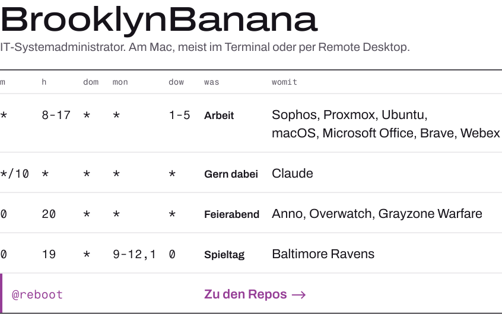

<a href="https://github.com/BrooklynBanana?tab=repositories">
  <picture>
    <source media="(prefers-color-scheme: dark) and (max-width: 640px)" srcset="assets/header-mobile-dark.svg">
    <source media="(prefers-color-scheme: dark)" srcset="assets/header-dark.svg">
    <source media="(max-width: 640px)" srcset="assets/header-mobile-light.svg">
    
  </picture>
</a>

<details>
<summary><code>crontab -l</code> als Text</summary>

```
# m    h     dom  mon     dow  was         womit
*      8-17  *    *       1-5  Arbeit      Sophos, Proxmox, Ubuntu, macOS, Microsoft Office, Brave, Webex
*/10   *     *    *       *    Gern dabei  Claude
0      20    *    *       *    Feierabend  Anno, Overwatch, Grayzone Warfare
0      19    *    9-12,1  0    Spieltag    Baltimore Ravens
@reboot                        https://github.com/BrooklynBanana?tab=repositories
```

</details>
